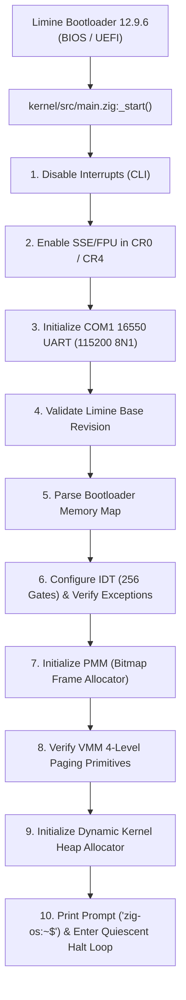

# ZIG-OS

[](https://ziglang.org/)
[](https://en.wikipedia.org/wiki/X86-64)
[](https://limine-bootloader.org/)
[](docs/ROADMAP.md)
[](LICENSE)

A freestanding, modern 64-bit operating system kernel developed from scratch using **Zig 0.17.1** for the **x86_64** (AMD64) architecture.

ZIG-OS is engineered with production rigor: strict modular isolation, zero C standard library dependencies, no runtime assumptions without hardware verification, and pure Zig implementations of all core kernel protocols, memory managers, and system structures.

---

## Table of Contents

- [Overview & Architectural Highlights](#overview--architectural-highlights)
- [System Architecture & Memory Layout](#system-architecture--memory-layout)
- [Core Subsystems](#core-subsystems)
  - [Bootloader & Protocol Interface](#bootloader--protocol-interface)
  - [CPU Control & Interrupt Subsystem](#cpu-control--interrupt-subsystem)
  - [Physical Memory Manager (PMM)](#physical-memory-manager-pmm)
  - [Virtual Memory Manager (VMM)](#virtual-memory-manager-vmm)
  - [Kernel Dynamic Heap Allocator](#kernel-dynamic-heap-allocator)
  - [Serial Driver & Diagnostics](#serial-driver--diagnostics)
- [Repository Structure](#repository-structure)
- [Prerequisites & Toolchain](#prerequisites--toolchain)
- [Building & Execution](#building--execution)
  - [Build Bootable Hybrid ISO](#build-bootable-hybrid-iso)
  - [Run in QEMU](#run-in-qemu)
  - [Kernel Debugging with GDB](#kernel-debugging-with-gdb)
  - [Automated Verification & Unit Tests](#automated-verification--unit-tests)
- [Development Roadmap](#development-roadmap)
- [Engineering Standards](#engineering-standards)
- [Documentation Reference](#documentation-reference)
- [License](#license)

---

## Overview & Architectural Highlights

- **Pure Zig Kernel**: Zero C/C++ in the kernel tree. Assembly is confined strictly to low-level ISR vector stubs and architectural control primitives.
- **Higher-Half Kernel Design**: Kernel code, read-only data, and writable sections are mapped to `-2 GiB` (`0xffffffff80000000`). Physical memory is accessed via the Higher Half Direct Map (HHDM).
- **Limine Boot Protocol v2**: Native, type-safe Zig bindings interfacing with Limine 12.9.6 for base revision verification, memory map discovery, and HHDM offset initialization.
- **Complete Interrupt Infrastructure**: Full 256-entry Interrupt Descriptor Table (IDT), 64-bit interrupt gates, normalized assembly vector stubs, complete CPU register preservation, and Page Fault (`#PF`) diagnostics with `CR2` decoding.
- **Memory Safety & Self-Testing**: PMM bitmap allocator with double-free detection, 4-level page table management (`invlpg`), segregated coalescing dynamic heap allocator with canary protection (`0xCAFEBABE`), and built-in boot self-tests.
- **Deterministic Toolchain**: Hybrid bootable ISO images (supporting both BIOS MBR and UEFI) created via `xorriso` and Limine installer.

---

## System Architecture & Memory Layout

```
+------------------------------------+ 0xffffffffffffffff
| High 2 GiB Kernel Code & Data      | (Mapped at 0xffffffff80000000)
|  - .text (RX)                      |
|  - .rodata (R)                     |
|  - .data / .bss / requests (RW)    |
+------------------------------------+ 0xffffffff80000000
| Dedicated Dynamic Kernel Heap      | 0xffff900000000000 - 0xffff900004000000 (64 MiB max)
+------------------------------------+
| Higher Half Direct Map (HHDM)      | (Direct 1:1 virtual mapping of physical RAM)
| Base offset provided by Limine     |
+------------------------------------+
| User Space (Phase 2+)              | 0x0000000000000000 - 0x00007fffffffffff
+------------------------------------+ 0x0000000000000000
```

### Kernel Initialization Flow



---

## Core Subsystems

### Bootloader & Protocol Interface
- **File**: `kernel/src/limine.zig`
- Implements the official Limine Boot Protocol v2 using Zig `extern struct` layouts for C-compatible ABI representation.
- Emits request tags (`limine_base_revision`, `limine_memmap_request`, `limine_hhdm_request`, `limine_kernel_address_request`) into dedicated ELF sections preserved by the linker script (`kernel/linker.ld`).

### CPU Control & Interrupt Subsystem
- **Files**: `kernel/src/arch/x86_64/cpu.zig`, `kernel/src/arch/x86_64/idt/idt.zig`, `kernel/src/arch/x86_64/idt/handlers.zig`, `kernel/src/arch/x86_64/interrupts/stubs.s`, `kernel/src/arch/x86_64/gdt/gdt.zig`
- **Control Registers**: Primitives for reading and writing `CR0`, `CR2`, `CR3`, `CR4`, segment registers, and port I/O (`inb`, `outb`, `ioWait`).
- **SSE/FPU Support**: Activates floating-point and SIMD instructions early by configuring `CR0` (clearing `EM`, setting `MP`) and `CR4` (setting `OSFXSR` and `OSXMMEXCPT`).
- **IDT Configuration**: 256 interrupt gates with `packed struct(u80)` `IDTR`.
- **Assembly ISR Stubs**: 256 vector stubs normalizing hardware error codes (pushing dummy `0` for vectors without error codes), pushing all 15 general-purpose registers (`RAX`..`R15`), clearing the Direction Flag (`cld`), and calling the central Zig dispatcher.
- **Exception Dispatch & Diagnostics**: Full architectural register dump upon CPU faults. Vector 14 (`#PF`) reads `CR2` and decodes cause flags (present vs. non-present, read vs. write, kernel vs. user, reserved bit, and instruction fetch NX).

### Physical Memory Manager (PMM)
- **File**: `kernel/src/mm/physical.zig`
- **Bitmap Allocator**: Tracks physical 4 KiB frames with 1-bit granularity.
- **Hardware Protection**: Protects the first 1 MiB (`0x0` - `0x100000`) and the allocation bitmap's own physical frames from reallocation.
- **Safety**: Zeroes allocated memory before handoff and detects double-frees with fatal assertions.
- **API**: `allocPage()`, `allocPages(count)`, `freePage(paddr)`, `freePages(paddr, count)`.

### Virtual Memory Manager (VMM)
- **File**: `kernel/src/mm/virtual.zig`
- **4-Level Paging**: Full support for `PML4` (L4), `PDPT` (L3), `PD` (L2), and `PT` (L1) hierarchies.
- **HHDM Access**: Translates physical page table addresses to higher-half virtual addresses seamlessly via bootloader HHDM offsets.
- **Translation & Invalidation**: Provides `virtToPhys()`, recursive page table allocation via PMM, `mapPage()`, `unmapPage()`, and TLB invalidation (`invlpg`).

### Kernel Dynamic Heap Allocator
- **File**: `kernel/src/mm/heap.zig`
- **Segregated / Coalescing Architecture**: Block headers contain a 32-byte descriptor, state magic (`0x55534544` / `0x46524545`), and verification canary (`0xCAFEBABE`).
- **On-Demand Expansion**: Expands into the heap virtual window (`0xffff900000000000` up to 64 MiB) by requesting physical frames from PMM and mapping them into the active page table via VMM.
- **Fragmentation Management**: Dynamic block splitting for allocations and bidirectional coalescing on deallocations.
- **Zig Compatibility**: Integrates with `std.mem.Allocator` via `heap.allocator()`.

### Serial Driver & Diagnostics
- **File**: `kernel/src/drivers/serial/serial.zig`
- **16550 UART COM1**: Initialized to 115200 baud, 8 data bits, no parity, 1 stop bit (8N1), with a 14-byte FIFO buffer threshold.
- **Hardware Loopback Test**: Executes a hardware register loopback self-test during boot to verify UART operation.
- **Panic Handler**: Custom freestanding panic handler in `kernel/src/panic.zig` writing diagnostics to the serial console before executing `cpu.haltLoop()`.

---

## Repository Structure

```
.
├── build.zig                  # Zig build system configuration (ISO, QEMU, GDB, tests)
├── build.zig.zon              # Zig package manifest
├── boot/
│   └── limine/                # Limine bootloader binaries (BIOS/UEFI), config & installer source
├── kernel/
│   ├── linker.ld              # Higher-half linker script (base: 0xffffffff80000000)
│   └── src/
│       ├── main.zig           # Kernel entry point (_start) and initialization pipeline
│       ├── limine.zig         # Pure Zig Limine protocol request & response bindings
│       ├── panic.zig          # Freestanding panic handler
│       ├── arch/x86_64/       # Architecture-specific implementation
│       │   ├── cpu.zig        # Control registers (CR0-CR4), MSRs, port I/O, halts
│       │   ├── gdt/gdt.zig    # Global Descriptor Table segment selectors and queries
│       │   ├── idt/           # IDT configuration and exception dispatch handlers
│       │   └── interrupts/    # Assembly ISR vector stubs (stubs.s)
│       ├── mm/                # Memory Management Subsystems
│       │   ├── physical.zig   # Physical Memory Manager (PMM bitmap allocator)
│       │   ├── virtual.zig    # Virtual Memory Manager (VMM 4-level paging)
│       │   └── heap.zig       # Kernel heap allocator with std.mem.Allocator adapter
│       └── drivers/
│           └── serial/        # COM1 16550 UART serial driver
├── docs/                      # Architectural specifications and engineering rules
│   ├── ARCHITECTURE.md        # Deep dive into memory layouts, CPU registers, and design
│   ├── BUILDING.md            # Comprehensive toolchain and execution instructions
│   ├── DEVELOPMENT_RULES.md   # Rigorous coding and architectural isolation rules
│   └── ROADMAP.md             # Multi-phase milestone roadmap
├── scripts/                   # Developer automation shell scripts
│   ├── build.sh               # ISO generation pipeline (xorriso + Limine installer)
│   ├── run.sh                 # QEMU launcher with serial output
│   ├── debug.sh               # QEMU GDB debug launcher (port 1234)
│   └── test-boot.sh           # Automated headless smoke test runner
└── tests/
    ├── unit_test.zig          # Host unit tests for core bitwise math & algorithms
    └── test_boot.py           # Python test harness for QEMU serial output validation
```

---

## Prerequisites & Toolchain

The following host tools are required:

| Tool | Required Version | Verification Command |
|---|---|---|
| **Zig Compiler** | `0.17.1` | `zig version` |
| **QEMU Emulator** | `>= 8.0` (`qemu-system-x86_64`) | `qemu-system-x86_64 --version` |
| **xorriso** | `>= 1.5` | `xorriso -version` |
| **GDB** | Any modern release | `gdb --version` |
| **Make / GCC** | Host toolchain | `make --version && gcc --version` |
| **Python** | `>= 3.8` (for test harness) | `python3 --version` |

---

## Building & Execution

### Build Bootable Hybrid ISO

Compile the kernel and assemble the bootable hybrid ISO (`build/zig-os.iso`):

```bash
# Using Zig build system
zig build iso

# Or using the build script directly
./scripts/build.sh
```

### Run in QEMU

Launch the operating system in QEMU with COM1 serial mapped directly to your terminal `stdio`:

```bash
# Using Zig build system
zig build run

# Or using the runner script
./scripts/run.sh
```

> **Note**: To exit QEMU, press `Ctrl + A`, release, then press `X`.

### Kernel Debugging with GDB

1. Launch QEMU paused at the entry point waiting for a GDB client on port `1234`:
   ```bash
   zig build debug
   # Or: ./scripts/debug.sh
   ```

2. In a separate terminal, attach GDB with symbol information:
   ```bash
   gdb -ex "target remote :1234" -ex "symbol-file zig-out/bin/kernel.elf"
   ```

3. Set breakpoints and commence debugging:
   ```gdb
   (gdb) break _start
   (gdb) continue
   ```

### Automated Verification & Unit Tests

#### 1. Host Unit Tests
Run algorithmic and memory math unit tests natively on your host machine:
```bash
zig build test
```

#### 2. Automated Boot Smoke Tests
Execute the automated test suite that boots the ISO in headless QEMU, verifies all initialization markers, checks system stability, and confirms zero kernel panics:

```bash
# Using Zig build system
zig build test-boot

# Or using the shell test script
./scripts/test-boot.sh

# Or using the Python verification harness
python3 tests/test_boot.py
```

Expected boot test verification output:
```
====================================
            ZIG-OS v0.1             
====================================

[BOOT] Limine boot protocol initialized.
[CPU] Architecture: x86_64
[KERNEL] Zig kernel entry reached.
[MEMORY] Bootloader memory map received.
[IDT] 256 interrupt gates configured and verified.
[PMM] Physical frame allocator initialized and verified.
[VMM] 4-level paging and translation primitives verified.
[HEAP] Dynamic memory allocator initialized and verified.
[STATUS] Kernel initialization complete.

zig-os:~$ 
```

---

## Development Roadmap


- [x] **Phase 0: Foundation**
  - Limine boot protocol bindings in pure Zig.
  - Higher-half kernel ELF linking (`0xffffffff80000000`).
  - 16550 UART serial logging and freestanding panic handler.
  - Hybrid bootable ISO creation and automated boot test harness.
- [x] **Phase 1: Core Kernel Infrastructure**
  - CPU control registers (`CR0`-`CR4`) and early SSE/SIMD enablement.
  - 256-entry IDT, assembly ISR vector stubs, and Page Fault diagnostics.
  - Physical Memory Manager (bitmap frame allocator, double-free detection).
  - Virtual Memory Manager (4-level paging, address translation, `invlpg`).
  - Kernel heap allocator (coalescing, canary checks, `std.mem.Allocator` adapter).
- [ ] **Phase 2: Processes & Multitasking**
  - Process Control Blocks (PCB) and Thread Control Blocks (TCB).
  - Assembly context switching (`push`/`pop` registers, RSP reload).
  - Preemptive round-robin scheduler driven by APIC timer / PIT.
  - System call interface via `syscall` / `sysret` MSRs.
  - Ring 3 user mode transitions and TSS installation.
- [ ] **Phase 3: Drivers & Hardware Subsystems**
  - PCI configuration space enumeration.
  - PS/2 keyboard and mouse controller driver with scancode decoding.
  - Precision timing with HPET and TSC.
  - Storage controller driver (AHCI SATA / NVMe).
- [ ] **Phase 4: Virtual Filesystem (VFS)**
  - Abstract VFS node interface (`open`, `read`, `write`, `close`, `readdir`, `stat`).
  - Ramfs / Initrd module loading via Limine.
  - Storage filesystem driver (FAT32 / ext2).
- [ ] **Phase 5: Userland & Native Shell**
  - Freestanding userland runtime library in Zig.
  - Process execution primitives.
  - Interactive terminal shell (`zig-os:~$`) running in user space.
  - Core utilities (`ls`, `cat`, `echo`, `ps`, `meminfo`, `clear`).

For detailed milestone breakdowns, refer to [docs/ROADMAP.md](docs/ROADMAP.md).

---

## Engineering Standards

This project adheres to strict operating systems engineering principles:
1. **Modularity**: Kernel subsystems (memory, drivers, interrupts, scheduling) communicate solely through clean abstractions.
2. **Architecture Isolation**: All x86_64-specific assembly, MSR accesses, and CPU instructions reside exclusively within `kernel/src/arch/x86_64/`.
3. **No Fake Functionality**: Hardware interactions follow official device specifications (e.g., 16550 UART, Intel/AMD 64-bit SDM). No simulated or mocked device replies.
4. **Deterministic & Warning-Free Builds**: The kernel builds cleanly under all optimization modes (`Debug`, `ReleaseSafe`, `ReleaseFast`, `ReleaseSmall`).
5. **Empirical Verification**: Milestones require verifiable proof via automated testing before commit.

Read [docs/DEVELOPMENT_RULES.md](docs/DEVELOPMENT_RULES.md) for full engineering specifications.

---

## Documentation Reference

- [Architecture Specification](docs/ARCHITECTURE.md): Detailed memory layout, register contracts, and paging design.
- [Build & Execution Guide](docs/BUILDING.md): Host toolchain setup, compilation options, and GDB debugging workflows.
- [Development Rules](docs/DEVELOPMENT_RULES.md): Kernel design tenets, architectural isolation, and Zig systems rules.
- [Roadmap](docs/ROADMAP.md): Detailed checklist of completed and planned development phases.

---

## License

This project is licensed under the MIT License. See [boot/limine/LICENSE](boot/limine/LICENSE) for the Limine bootloader license.
