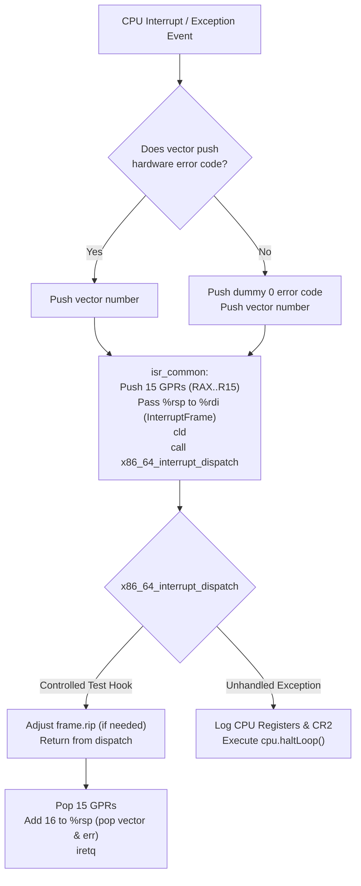

# ZIG-OS Architecture Specification

## 1. Overview & Architectural Principles

ZIG-OS is a production-oriented, freestanding 64-bit operating system developed from scratch using **Zig 0.17.1** and targeting the **x86_64** (AMD64) architecture.

### Core Architectural Decisions
- **Host OS**: Ubuntu Linux / POSIX compliant host.
- **Kernel Language**: Zig 0.17.1.
- **Freestanding Mode**: Kernel executes without libc or host OS dependencies.
- **No C/C++ in Kernel**: All kernel modules, drivers, protocol bindings, and data structures are written in pure Zig. Assembly is restricted to low-level ISR vector stubs and CPU instructions.
- **Bootloader**: Limine 12.9.6 adhering to the official Limine Boot Protocol.
- **Linker**: LLVM LLD via the Zig build system.
- **Target ABI**: x86-64 System V ABI with the 128-byte red zone disabled (`-mno-red-zone`), SSE/FPU enabled via CR0/CR4.
- **Memory Layout**: Higher-half kernel mapped at `-2 GiB` (`0xffffffff80000000`), Higher Half Direct Map (HHDM) for physical memory access.

---

## 2. CPU & Interrupt Subsystem (Phase 1)

### 2.1 GDT Rationale & Selector Management
Limine 12.9.6 prepares a valid 64-bit flat GDT prior to kernel entry:
- Code Segment Selector: `0x28` (Ring 0, 64-bit code)
- Data Segment Selector: `0x30` (Ring 0, 64-bit data)

In accordance with Phase 1 design requirements, Limine's GDT is documented and preserved during Phase 1 kernel mode execution. IDT gates dynamically query `getCs()` to eliminate hardcoded selector dependencies. A custom GDT with a Task State Segment (TSS) will be loaded in Phase 2 for Ring 3 privilege transitions.

### 2.2 IDT & Assembly ISR Stubs
- **256 Interrupt Gates**: Fully populated with 64-bit Interrupt Gate descriptors (`0x8E` = Present, DPL 0, 64-bit Interrupt Gate).
- **Exception Gate Validation**: `idt.validateExceptionGates()` verifies during boot that IDTR points to `idt_table`, every gate (including exceptions `0..31`) uses `0x8E` (Present, DPL=0, 64-bit Interrupt Gate), current CS selector (`gdt.getCs()`), cleared reserved fields, exact `isr_stub_table[i]` offsets, and distinct exception stub addresses.
- **IDTR Register**: Defined as `packed struct(u80)` (16-bit limit at offset 0, 64-bit base at offset 2, total 10 bytes).
- **Error Code Normalization**:
  - Vectors 8, 10, 11, 12, 13, 14, 17, 21, 29, 30 push a CPU hardware error code.
  - All other vectors push a dummy error code `0`.
  - Stubs push vector number, 15 general-purpose registers (RAX..R15), clear the Direction Flag (`cld`), and invoke `x86_64_interrupt_dispatch(&frame)`.



### 2.3 Page Fault Diagnostics (#PF, Vector 14)
When a page fault occurs:
- The faulting linear address is retrieved from the `CR2` register.
- The error code is decoded into semantic fields:
  - Bit 0 (`P`): Page-protection violation vs. non-present page.
  - Bit 1 (`W/R`): Write access vs. read access.
  - Bit 2 (`U/S`): User mode vs. supervisor/kernel mode.
  - Bit 3 (`RSVD`): Reserved bit set in page table entry.
  - Bit 4 (`I/D`): Instruction fetch violation (NX).

### 2.4 Interrupt Vector Policy & Legacy 8259 PIC Remapping
- **Vector Space Partition (`kernel/src/arch/x86_64/interrupts/vectors.zig`)**: Vectors `0–31` are strictly reserved for CPU architectural exceptions (`FIRST_EXTERNAL_VECTOR = 32`); external IRQs, APIC/IOAPIC/LAPIC, MSI/MSI-X, IPIs, and general software interrupts are restricted to vectors `32–255`.
- **Software `INT n` Isolation**: Only controlled `#BP` (`int $3`) self-testing and external vectors (`>= 32`) are allowed in kernel source; issuing `int <n>` for error-code vectors (`8, 10, 11, 12, 13, 14, 17, 21, 29, 30`) or non-breakpoint exception vectors is forbidden and caught statically by host tests.
- **Legacy 8259 PIC Isolation (`kernel/src/arch/x86_64/interrupts/pic.zig`)**: Before IDT activation (while `IF=0`), `pic.remapAndMask()` remaps master/slave PICs to `0x20–0x27` / `0x28–0x2F` and masks all 16 IRQ lines (`0xFF`/`0xFF`) with IMR readback verification, preventing BIOS default PIC vectors (`0x08–0x0F`) from colliding with `#DF`/`#TS`/`#NP`/`#SS`/`#GP`/`#PF` or masking `sti` hazards.

---

## 3. Memory Architecture (Phase 1)

```
+------------------------------------+ 0xffffffffffffffff
| High 2 GiB Kernel Code & Data      | (Mapped at 0xffffffff80000000)
|  - .text (RX)                      |
|  - .rodata (R)                     |
|  - .data / .bss / requests (RW)    |
+------------------------------------+ 0xffffffff80000000
| Dedicated Dynamic Kernel Heap      | 0xffff900000000000 - 0xffff900004000000 (64 MiB max)
+------------------------------------+
| Higher Half Direct Map (HHDM)      | (Direct 1:1 virtual mapping of all physical RAM)
| Base provided by Limine            |
+------------------------------------+
| User Space (Phase 2+)              | 0x0000000000000000 - 0x00007fffffffffff
+------------------------------------+ 0x0000000000000000
```

### 3.1 Physical Memory Manager (PMM)
- **Bitmap Allocator**: Tracks all physical 4 KiB frames using a byte bitmap placed in the first sufficiently large usable physical memory region.
- **Classification**:
  - Memory below 1 MiB (0x0..0x100000) is locked/reserved for hardware compatibility.
  - All non-USABLE regions (reserved, ACPI, bad memory, bootloader-reclaimable, kernel image) are marked as 1 (USED).
  - The bitmap's own physical frame range is explicitly marked as USED to prevent self-overwrite.
- **Double-Free Detection**: If `freePage` encounters a bit already marked 0, an immediate panic is raised.
- **Security & Determinism**: All allocated pages are zeroed before being handed to callers.

### 3.2 Virtual Memory Manager (VMM)
- **4-Level Paging**: PML4 (L4) -> PDPT (L3) -> PD (L2) -> PT (L1).
- **HHDM Translation**: All table accesses use `physToVirt(paddr) = paddr + hhdm_offset`.
- **Primitives**:
  - `mapPage(pml4, virt, phys, flags)`: Automatically allocates intermediate tables from PMM.
  - `unmapPage(pml4, virt)`: Clears PT entry and executes `invlpg`.
  - `virtToPhys(pml4, virt)`: Traverses page hierarchy supporting 4 KiB, 2 MiB, and 1 GiB page entries.

### 3.3 Kernel Heap Allocator
- **Segregated / Coalescing Dynamic Allocator**:
  - Blocks contain a 32-byte header with a verification canary (`0xCAFEBABE`) and state magic (`0x55534544` / `0x46524545`).
  - Automatic block splitting for minimal internal fragmentation.
  - Bidirectional coalescing on `deallocate()` when adjacent blocks are free.
  - On-demand expansion: allocates physical frames from PMM and maps them into the heap window via VMM.
  - Implements the standard Zig `std.mem.Allocator` interface.
