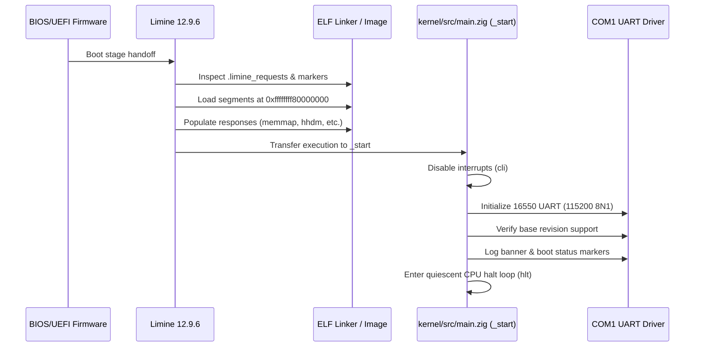

# ZIG-OS Architecture Specification

## 1. Overview & Architectural Principles

ZIG-OS is a production-oriented, freestanding 64-bit operating system developed from scratch using **Zig 0.17.1** and targeting the **x86_64** (AMD64) architecture.

### Core Architectural Decisions
- **Host OS**: Ubuntu Linux / POSIX compliant host.
- **Kernel Language**: Zig 0.17.1.
- **Freestanding Mode**: Kernel executes without libc or host OS dependencies.
- **No C/C++ in Kernel**: All kernel modules, drivers, protocol bindings, and data structures are written in pure Zig. Minimal assembly is restricted to low-level architecture-specific operations.
- **Bootloader**: Limine 12.9.6 adhering to the official Limine Boot Protocol.
- **Linker**: LLVM LLD via the Zig build system.
- **Target ABI**: x86-64 System V ABI without floating point / vector registers and with the 128-byte red zone disabled (`-mno-red-zone`).
- **Memory Layout**: Higher-half kernel mapped at `-2 GiB` (`0xffffffff80000000`).

---

## 2. Boot Flow & Protocol Contract

The boot process leverages Limine 12.9.6 in 64-bit long mode. The Limine bootloader locates the boot entry in `boot/limine/limine.conf`, sets up basic 4-level paging, loads the kernel ELF segments, parses the kernel's request tags, and jumps to the kernel entry point.



### Limine Request Protocol Details
Requests are placed between start and end markers inside the writable `.data` section:
1. `requests_start_marker`: 4 64-bit magic numbers (`0xf6b8f4b39de7d1ae`, `0xfab91a6940fcb9cf`, `0x785c6ed015d3e316`, `0x181e920a7852b9d9`).
2. `base_revision`: Tag requesting Base Revision 3 (`0xf9562b2d5c95a6c8`, `0x6a7b384944536bdc`, `3`). On success, the bootloader zeroes the 3rd element.
3. Feature requests:
   - `memmap_request`: Requests the physical memory map.
   - `hhdm_request`: Requests the Higher Half Direct Map offset.
   - `bootloader_info_request`: Requests bootloader name and version.
   - `stack_size_request`: Requests 64 KiB initial stack.
4. `requests_end_marker`: 2 64-bit magic numbers (`0xadc0e0531bb10d03`, `0x9572709f31764c62`).

---

## 3. Kernel Virtual Memory Layout

```
+------------------------------------+ 0xffffffffffffffff
| High 2 GiB Kernel Code & Data      | (Mapped at 0xffffffff80000000)
|  - .text (RX)                      |
|  - .rodata (R)                     |
|  - .data / .bss / requests (RW)    |
+------------------------------------+ 0xffffffff80000000
| ...                                |
+------------------------------------+
| Higher Half Direct Map (HHDM)      | (Direct mapping of physical RAM)
| Base determined by bootloader      |
+------------------------------------+
| User Space (Phase 2+)              | 0x0000000000000000 - 0x00007fffffffffff
+------------------------------------+ 0x0000000000000000
```

---

## 4. Subsystem Layout

```
kernel/
  ├── linker.ld               # ELF layout definition
  └── src/
      ├── main.zig            # Entry point & boot orchestration
      ├── panic.zig           # Freestanding panic handler
      ├── limine.zig          # Typed Limine protocol structures
      ├── arch/
      │   └── x86_64/
      │       ├── cpu.zig     # Inb/outb, cli/sti, hlt instructions
      │       ├── gdt/        # Global Descriptor Table (Phase 1)
      │       └── idt/        # Interrupt Descriptor Table (Phase 1)
      ├── drivers/
      │   ├── serial/
      │   │   └── serial.zig  # 16550 UART driver
      │   └── framebuffer/    # Graphical console (Phase 1)
      ├── mm/
      │   ├── physical.zig    # Bitmap/Buddy PMM (Phase 1)
      │   ├── virtual.zig     # Page table manager (Phase 1)
      │   └── heap.zig        # Kernel slab/buddy allocator (Phase 1)
      ├── process/            # Process control blocks (Phase 2)
      ├── scheduler/          # Task scheduler (Phase 2)
      ├── syscall/            # System call interface (Phase 2)
      └── lib/                # Utility data structures
```

---

## 5. Serial Driver & Diagnostics

The serial driver interacts with COM1 at standard I/O port `0x3F8`:
- Clock divisor set to `1` (115200 baud).
- Line control configured to 8 data bits, 1 stop bit, no parity (8N1).
- 16-byte FIFO enabled and cleared.
- Hardware loopback diagnostic executed during `init()` to verify transceiver presence.
- Output polling with status register checks ensuring zero dropped characters.
- Custom panic handler dumps error cause and return address directly to COM1 before halting the CPU.
