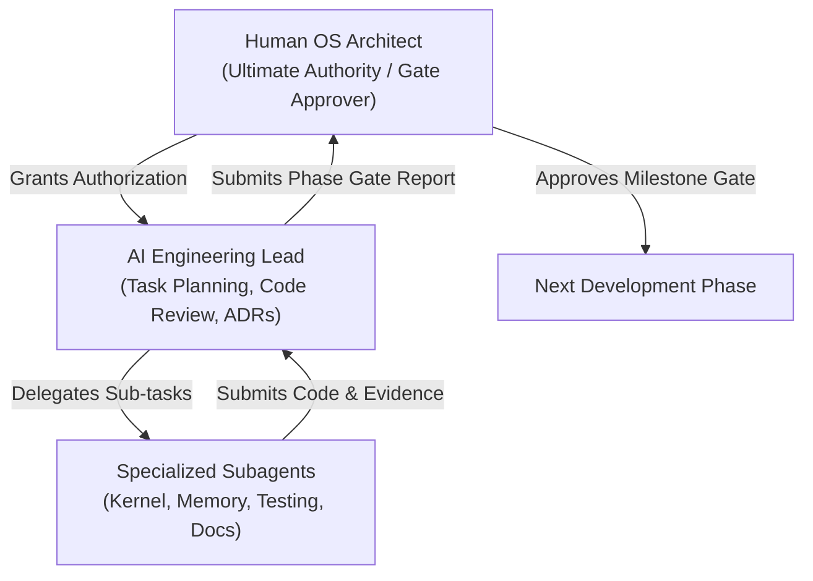

# ZIG-OS Engineering Governance Framework

## 1. Governance Charter & Overview
This document defines the formal engineering governance model for **ZIG-OS**. It establishes strict operational boundaries, review gates, and decision-making authority for all human contributors and autonomous AI agents working within this repository.

---

## 2. Roles & Responsibilities



### 2.1 Human Operating System Architect
- Holds ultimate authority over all architectural decisions, milestone gates, and repository commits.
- Evaluates Phase Gate submissions and grants explicit authorization before a new milestone or phase commences.
- Approves all dependency modifications and toolchain upgrades.

### 2.2 AI Engineering Lead & Subagents
- Operates strictly within the scope of the explicitly authorized task and phase.
- Conducts pre-task repository and Git inspections before modifying files.
- Formulates formal plans and creates Architecture Decision Records (ADRs) for significant design choices.
- Submits empirical evidence for every verification claim.
- **Never starts an unapproved phase or marks a phase complete without independent verification.**

---

## 3. Development Workflow (The 6-Step Cycle)

Every development task must follow the structured 6-step lifecycle:

```
[1. INSPECT] -> [2. PLAN] -> [3. REVIEW] -> [4. IMPLEMENT] -> [5. VERIFY] -> [6. GATE]
```

1. **INSPECT**:
   - Check `git status`, `git branch`, and recent commits (`git log -n 5`).
   - Inspect affected subsystems, data structures, and existing rules.
   - Verify toolchain version (`zig version == 0.17.1`).
2. **PLAN**:
   - Create an implementation plan detailing scope, risks, and acceptance criteria.
   - Document any architectural decisions in `docs/adr/`.
3. **REVIEW**:
   - Evaluate against safety invariants, memory rules, and calling conventions.
   - Identify potential regressions in previously verified modules.
4. **IMPLEMENT**:
   - Apply minimal, modular changes in pure Zig.
   - Strictly isolate architecture-dependent code in `kernel/src/arch/x86_64/`.
5. **VERIFY**:
   - Execute static analysis and compilation checks.
   - Execute host unit tests (`zig build test`).
   - Execute headless QEMU integration tests (`./scripts/test-boot.sh`).
   - Collect empirical logs and verify against acceptance criteria.
6. **GATE**:
   - Compile Phase Gate Report.
   - Await human approval before advancing to subsequent milestones.

---

## 4. Code & Architecture Review Standards

### 4.1 Architectural Review Checklist
Before any code is committed or merged into `main`:
- [ ] Does the change violate zero C/C++ in the kernel?
- [ ] Is architecture-specific code isolated inside `kernel/src/arch/x86_64/`?
- [ ] Are physical memory addresses properly wrapped with `physToVirt` via HHDM?
- [ ] Are all hardware register bitfields represented as `packed struct`?
- [ ] Are all external protocols defined as `extern struct`?
- [ ] Is the 128-byte red zone disabled?
- [ ] Does stack manipulation guarantee 16-byte alignment before calling C/Zig ABI functions?
- [ ] Are all memory allocations checked for failure, double-free, and bounds integrity?

### 4.2 Quality Assurance Checklist
- [ ] Zero compiler warnings or errors under `-Doptimize=Debug` and `-Doptimize=ReleaseSafe`.
- [ ] Host unit tests pass cleanly.
- [ ] QEMU boots without triple faults, infinite exception loops, or premature reboot.
- [ ] Normal production boot halts safely in a quiescent CPU halt (`hltLoop`).

---

## 5. Change Management & Git Policies

To ensure repository stability and prevent accidental loss of work:
- **No Destructive Commands**: `git reset --hard`, `git clean -fd`, and `git checkout -- .` are strictly prohibited.
- **Preserve Untracked Assets**: Binary archives (such as `zig.zip`) or untracked test fixtures must not be deleted.
- **Explicit Commit Mandate**: Autonomous agents must not create commits unless explicitly authorized in the task brief.
- **Atomic, Semantic Commits**: When authorized, commits must follow Conventional Commits format (`feat(kernel): ...`, `fix(vmm): ...`, `docs(adr): ...`).

---

## 6. Documentation Standards

All engineering documentation must remain accurate and synchronized:
- **`docs/ARCHITECTURE.md`**: Master living blueprint of kernel subsystems and memory maps.
- **`docs/ROADMAP.md`**: High-level phase status tracking. Status markers must reflect real, verified milestones.
- **`docs/adr/`**: Immutable records of architectural decisions.
- **`AGENTS.md` & `.agents/rules/`**: Master and specialized guidelines governing agent behavior.
