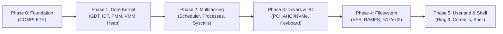

# ZIG-OS Development Roadmap

---

## Phase 0: Foundation (Current - Status: COMPLETE)
- [x] Host toolchain inspection and Zig 0.17.1 verification.
- [x] Limine 12.9.6 protocol analysis and pure Zig protocol binding.
- [x] Freestanding x86_64 target configuration (`-mcmodel=kernel`, `-mno-red-zone`, LLVM LLD).
- [x] Higher-half ELF linker script (`0xffffffff80000000`).
- [x] Limine boot configuration (`boot/limine/limine.conf`).
- [x] Kernel entry point in Zig (`_start`).
- [x] 16550 UART COM1 serial driver and formatted logging.
- [x] Freestanding panic handler with diagnostic crash reporting.
- [x] Hybrid bootable ISO creation with `xorriso` and `limine bios-install`.
- [x] QEMU execution script (`scripts/run.sh`).
- [x] GDB debugging configuration (`scripts/debug.sh`).
- [x] Automated boot smoke test verifying serial output and stability (`scripts/test-boot.sh`).

---

## Phase 1: Core Kernel Infrastructure (Current - Status: COMPLETE)
- [x] **GDT Management**: Preserved and documented Limine 64-bit kernel descriptors (CS: `0x28`, DS: `0x30`), with dynamic selector querying for IDT gates.
- [x] **IDT & 256 Gates**: Full 256-entry Interrupt Descriptor Table with 64-bit Interrupt Gate descriptors and `packed struct(u80)` IDTR.
- [x] **ISR Assembly Stubs**: 256 assembly vector stubs handling error codes vs dummy error codes, saving 15 GPRs, clearing direction flag (`cld`), and calling Zig dispatcher.
- [x] **CPU Exception Handlers**: Exception dispatch with full diagnostic logging for vectors 0..31, controlled non-fatal test hooks, and safe `hltLoop` on unrecoverable faults.
- [x] **Page Fault Diagnostics (#PF)**: CR2 faulting linear address reading and bitfield decoding (Present, Write/Read, User/Supervisor, Reserved bit, Instruction fetch NX).
- [x] **SSE / FPU Enablement**: Configured CR0 (cleared EM, set MP) and CR4 (OSFXSR, OSXMMEXCPT) for reliable compiler SIMD code execution.
- [x] **Physical Memory Manager (PMM)**: Bitmap physical frame allocator, parsing Limine memory map and HHDM offset, reserving bootloader/kernel regions, 4 KiB `allocPage`/`allocPages`/`freePage`/`freePages`, with double-free protection.
- [x] **Virtual Memory Manager (VMM)**: 4-level paging (PML4, PDPT, PD, PT), page mapping (`mapPage`), unmapping (`unmapPage`), translation (`virtToPhys`), and TLB invalidation (`invlpg`).
- [x] **Kernel Heap Allocator**: Production-quality segregated/coalescing dynamic heap allocator backed by PMM & VMM, memory bounds validation, header canaries (`0xCAFEBABE`), invalid free and double-free detection, and Zig `std.mem.Allocator` adapter.
- [x] **Automated Verification**: Host-side unit tests (`tests/unit_test.zig`), controlled in-kernel exception dispatch tests, controlled page fault tests, PMM alloc/free tests, VMM mapping tests, Heap allocation tests, and QEMU smoke test suites.

---

## Phase 2: Processes & Multitasking
- [ ] Process Control Blocks (PCB) and Thread Control Blocks (TCB).
- [ ] Context switching in assembly (`push`/`pop` general purpose registers, RSP reload).
- [ ] Preemptive round-robin scheduler driven by APIC timer / PIT.
- [ ] System call interface using `syscall` / `sysret` MSRs (STAR, LSTAR, SFMASK).
- [ ] Ring 3 user mode privilege transitions.

---

## Phase 3: Drivers & Hardware Subsystems
- [ ] PCI configuration space enumeration and capability discovery.
- [ ] PS/2 keyboard and mouse controller driver with scancode decoding.
- [ ] Precision timing with HPET (High Precision Event Timer) and TSC.
- [ ] Storage driver: AHCI (SATA) or NVMe controller driver.

---

## Phase 4: Virtual Filesystem (VFS)
- [ ] Abstract VFS node interface (open, read, write, close, readdir, stat).
- [ ] In-memory ramfs / initrd module loading via Limine module feature.
- [ ] Read/Write storage filesystem driver (FAT32 or ext2).

---

## Phase 5: Userland & Native Shell
- [ ] Freestanding userland runtime library in Zig.
- [ ] Standard I/O and process execution primitives (`fork`/`exec` or `spawn`).
- [ ] Interactive terminal shell running as a separate Ring 3 process (`zig-os:~$`).
- [ ] Core utilities: `ls`, `cat`, `echo`, `ps`, `meminfo`, `clear`.
