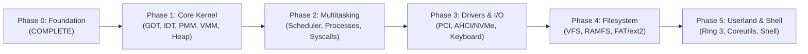

# ZIG-OS Development Roadmap

---

## Phase 0: Foundation (Current - Status: COMPLETE)
- [x] Host toolchain inspection and Zig 0.17.1 verification.
- [x] Limine 12.9.6 protocol analysis and pure Zig protocol binding.
- [x] Freestanding x86_64 target configuration (`-mcmodel=kernel`, `-mno-red-zone`, LLVM LLD).
- [x] Higher-half ELF linker script (`0xffffffff80000000`).
- [x] Limine boot configuration (`boot/limine/limine.conf`).
- [x] Kernel entry point in Zig (`_start`).
- [x] 16550 UART COM1 serial driver and formatted logging.
- [x] Freestanding panic handler with diagnostic crash reporting.
- [x] Hybrid bootable ISO creation with `xorriso` and `limine bios-install`.
- [x] QEMU execution script (`scripts/run.sh`).
- [x] GDB debugging configuration (`scripts/debug.sh`).
- [x] Automated boot smoke test verifying serial output and stability (`scripts/test-boot.sh`).

---

## Phase 1: Core Kernel Infrastructure
- [ ] **GDT**: 64-bit Global Descriptor Table setup with Kernel Code, Kernel Data, User Code, User Data, and TSS.
- [ ] **IDT & Exceptions**: Interrupt Descriptor Table with 32 CPU exception handlers, Page Fault decoding, and register state dumping.
- [ ] **Interrupt Controller**: Advanced Programmable Interrupt Controller (APIC) initialization and Legacy PIC masking.
- [ ] **Physical Memory Manager (PMM)**: Bitmap or Buddy allocator parsing Limine memory map entries and managing free physical frames.
- [ ] **Virtual Memory Manager (VMM)**: 4-level page table manipulator, kernel address space mapping, and HHDM translation.
- [ ] **Kernel Heap Allocator**: Slab / pool / buddy allocator for dynamic kernel allocations.
- [ ] **Linear Framebuffer Console**: Text rendering over Limine framebuffer for screen output.

---

## Phase 2: Processes & Multitasking
- [ ] Process Control Blocks (PCB) and Thread Control Blocks (TCB).
- [ ] Context switching in assembly (`push`/`pop` general purpose registers, RSP reload).
- [ ] Preemptive round-robin scheduler driven by APIC timer / PIT.
- [ ] System call interface using `syscall` / `sysret` MSRs (STAR, LSTAR, SFMASK).
- [ ] Ring 3 user mode privilege transitions.

---

## Phase 3: Drivers & Hardware Subsystems
- [ ] PCI configuration space enumeration and capability discovery.
- [ ] PS/2 keyboard and mouse controller driver with scancode decoding.
- [ ] Precision timing with HPET (High Precision Event Timer) and TSC.
- [ ] Storage driver: AHCI (SATA) or NVMe controller driver.

---

## Phase 4: Virtual Filesystem (VFS)
- [ ] Abstract VFS node interface (open, read, write, close, readdir, stat).
- [ ] In-memory ramfs / initrd module loading via Limine module feature.
- [ ] Read/Write storage filesystem driver (FAT32 or ext2).

---

## Phase 5: Userland & Native Shell
- [ ] Freestanding userland runtime library in Zig.
- [ ] Standard I/O and process execution primitives (`fork`/`exec` or `spawn`).
- [ ] Interactive terminal shell running as a separate Ring 3 process (`zig-os:~$`).
- [ ] Core utilities: `ls`, `cat`, `echo`, `ps`, `meminfo`, `clear`.
