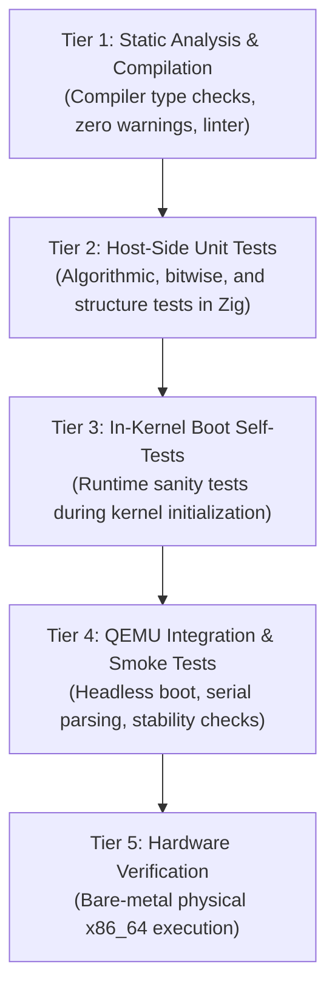

# ZIG-OS Testing & Quality Assurance Policy

## 1. Quality Mission & Invariants
In **ZIG-OS**, no subsystem is considered functional based on source code presence alone. Passing compilation does not prove kernel correctness, and host-side execution does not prove freestanding bare-metal behavior. Every functional claim must be backed by empirical test logs.

---

## 2. The Verification Pyramid

Testing in ZIG-OS is structured across five distinct verification tiers:



---

## 3. Standard Verification Labels

Every status assertion, milestone claim, and documentation update must utilize one of these standardized verification labels:

| Verification Label | Strict Technical Definition | Permitted Claim Scope |
|---|---|---|
| `NOT IMPLEMENTED` | File or function does not exist or contains empty signatures/stubs. | No claims permitted. |
| `IMPLEMENTED` | Code has been authored, but has not yet been compiled or executed. | Syntax written only; no functionality implied. |
| `BUILD VERIFIED` | Successfully compiled with Zig 0.17.1 and LLVM LLD without errors or warnings. | Syntactically and type valid; runtime behavior unverified. |
| `UNIT TEST VERIFIED` | Verified by executing host-side unit tests via `zig build test`. | Logic, mathematics, and algorithms verified in host userspace. |
| `QEMU VERIFIED` | Successfully booted inside QEMU with serial log evidence and quiescent CPU halt. | Verified within virtualized freestanding execution environment. |
| `HARDWARE VERIFIED` | Verified on physical x86_64 bare-metal hardware. | Verified on target silicon with real peripherals. |
| `PRODUCTION READY` | Formally code-reviewed, fuzz-tested, stress-tested, and audited. | Production quality across all build modes. |

---

## 4. Test Categories & Execution Protocols

### 4.1 Host-Side Unit Tests (`tests/unit_test.zig`, `tests/pmm_test.zig`, `tests/vmm_test.zig`, `tests/heap_test.zig`, `tests/vector_policy_test.zig`)
- **Execution Command**: `zig build test`
- **Scope**: Memory calculations, paging address decomposition, bitfield encoding/decoding, bitmap frame indexing, allocator chunk header integrity, interrupt vector reservation & PIC offset policy (`vectors.zig`), and static source scanning of `kernel/` (`.zig`, `.s`, `.S`, `.asm`) to forbid `int <n>` on error-code and non-breakpoint reserved exception vectors.
- **Limitation**: Executes under host Linux virtual memory. Does **not** verify privileged CPU instructions, hardware interrupts, or physical MMIO.

### 4.2 In-Kernel Runtime Self-Tests
- **Scope**: Executed during early boot sequence before handing off to userland:
  - Legacy PIC remap & mask verification: `pic.remapAndMask()` remaps 8259 PICs to `0x20–0x2F` and verifies IMRs read back `0xFF`/`0xFF` (`[PIC]` marker).
  - IDT gate validation: `idt.validateExceptionGates()` verifies `0x8E` (Present, DPL=0, 64-bit Interrupt Gate), current kernel CS, cleared reserved fields, and distinct exception stub addresses across vectors `0..31` (and all 256 gates).
  - IDT self-test: Software interrupt (`int $3`) dispatch and return.
  - Page Fault self-test: Controlled `#PF` test hook validating CR2 linear address and error flags.
  - PMM self-test: Single and multi-page allocation, free, re-allocation, and double-free rejection.
  - VMM self-test: Virtual-to-physical translation (`virtToPhys`), dynamic table allocation, page unmapping, and TLB flush (`invlpg`).
  - Heap self-test: Small/large allocations, chunk alignment, header canary verification (`0xCAFEBABE`), and free coalescing.
- **Safety Policy**: Self-tests must be strictly non-destructive and must not crash or halt the system during normal production boot.

### 4.3 Headless QEMU Smoke Tests (`scripts/test-boot.sh`, `tests/test_boot.py`)
- **Execution Command**: `./scripts/test-boot.sh` or `python3 tests/test_boot.py`
- **Scope**: Boots `build/zig-os.iso` in headless QEMU, captures COM1 serial output, asserts required boot strings, and monitors process state to confirm quiescent CPU halt.
- **Criteria for Success**:
  1. All expected serial markers are present in exact chronological sequence.
  2. QEMU executes without triggering triple faults, reboot loops, or unhandled CPU exceptions.
  3. CPU remains stable in a low-power `hlt` quiescent loop.

### 4.4 Hardware Bare-Metal Testing
- **Protocol**: Flash hybrid ISO (`build/zig-os.iso`) to USB drive via `dd` or deploy via PXE.
- **Validation**: Capture serial output via physical RS-232 COM port or UEFI screen framebuffer.

---

## 5. Failure Reporting & Evidence Standards

Every test failure report must include:
1. **Command Executed**: Full command string including flags.
2. **Exit Code**: Exact return code.
3. **Captured Output**: Raw console or serial logs.
4. **Root Cause Analysis**: Technical hypothesis explaining the defect.
5. **Remediation Plan**: Non-destructive, incremental correction steps.

```markdown
### Test Execution Evidence Example
- **Command**: `./scripts/test-boot.sh`
- **Exit Status**: 0
- **Log Snippet**:
  ```
  [IDT] 256 interrupt gates configured and verified.
  [PMM] Physical frame allocator initialized and verified.
  [VMM] 4-level paging and translation primitives verified.
  [HEAP] Dynamic memory allocator initialized and verified.
  [STATUS] Kernel initialization complete.
  zig-os:~$
  ```
- **Result**: ALL CHECKS PASSED. QEMU process 1252884 stable in hlt loop.
```
