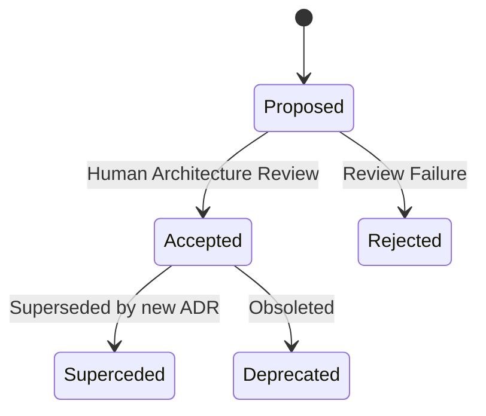

# ZIG-OS Architecture Decision Records (ADRs)

## 1. What is an ADR?
An **Architecture Decision Record (ADR)** captures a significant architectural decision along with its context, alternatives evaluated, trade-offs, and consequences. In **ZIG-OS**, every major architectural design choice must be documented as an ADR before implementation commences.

---

## 2. ADR Lifecycle & Statuses



- **PROPOSED**: Submitted for architectural review; not yet authorized for implementation.
- **ACCEPTED**: Formally approved by human OS architect; active system specification.
- **REJECTED**: Evaluated and discarded with documented rationale.
- **SUPERCEDED**: Replaced by a subsequent ADR (must reference replacing ADR number).
- **DEPRECATED**: Phased out or no longer applicable.

---

## 3. Required ADR Template

Every new ADR must be stored in `docs/adr/` named `XXXX-short-title.md` (e.g. `0001-higher-half-memory-layout.md`) and follow this format:

```markdown
# ADR-XXXX: [Short Title]

## Status
[PROPOSED | ACCEPTED | REJECTED | SUPERCEDED by ADR-YYYY | DEPRECATED]
Date: YYYY-MM-DD
Author: [Agent / Engineer Name]

## Context
What problem are we trying to solve? What architectural constraints exist?
Explain the technical motivation, hardware limitations, and design pressures.

## Decision
What is the specific architectural change or design choice?
Describe the concrete interfaces, data structures, algorithms, and contracts.

## Alternatives Considered
1. Alternative A: Description and reasons for rejection.
2. Alternative B: Description and reasons for rejection.

## Consequences
### Positive
- Specific benefits, performance gains, or architectural clarity.
### Negative / Trade-offs
- Added complexity, memory footprint, or constraints introduced.

## Security Implications
How does this decision affect privilege boundaries, isolation, memory safety,
and the kernel attack surface?

## Testing & Verification Implications
How will this architectural decision be validated?
Specify host unit tests, in-kernel self-tests, and QEMU integration tests.
```

---

## 4. Master ADR Index

| ADR # | Title | Status | Date | Subsystem |
|---|---|---|---|---|
| **[0001](0001-higher-half-kernel-memory-layout.md)** | Higher-Half Kernel Memory Layout & HHDM Access | ACCEPTED | 2026-11-10 | Memory / Architecture |
| **[0002](0002-pure-zig-freestanding-kernel.md)** | Pure Zig Freestanding Kernel (No C/C++) | ACCEPTED | 2026-11-10 | Core Language |
| **[0003](0003-limine-gdt-preservation-phase1.md)** | Limine GDT Preservation in Phase 1 | ACCEPTED | 2026-11-10 | CPU / Segmentation |
| **[0004](0004-segregated-heap-allocator-canaries.md)** | Segregated Coalescing Heap Allocator with Canaries | ACCEPTED | 2026-11-10 | Heap / Memory |
